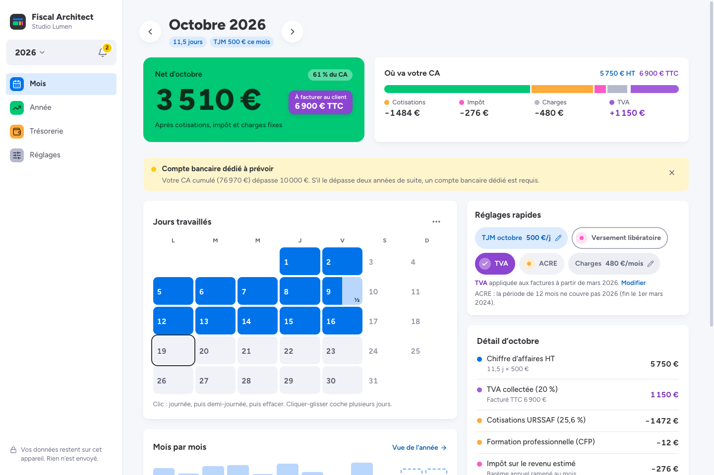
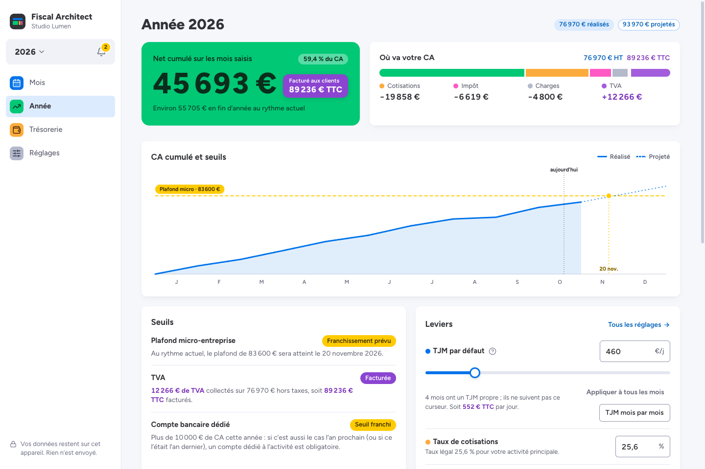
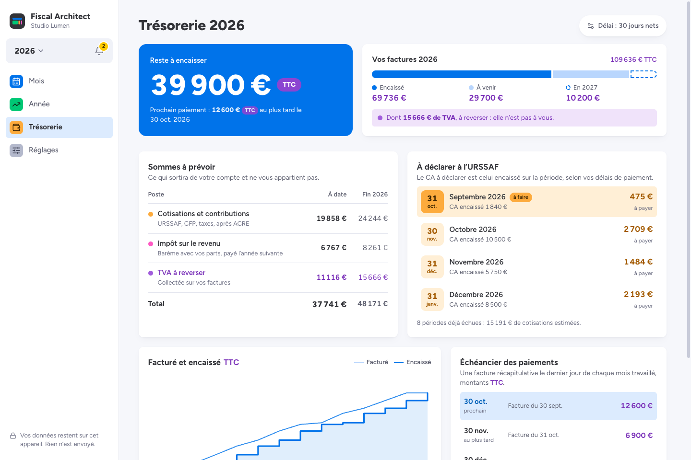
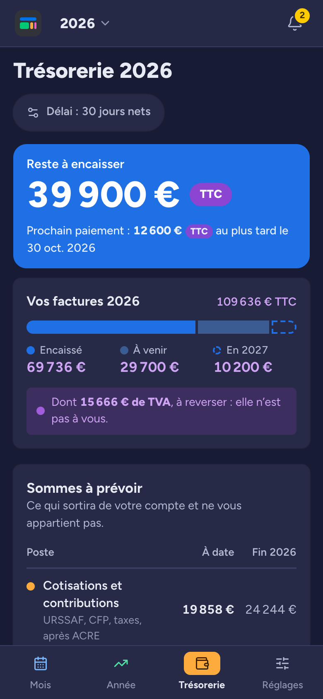

**English** · [Français](./README.fr.md)

<div align="center">

# Fiscal Architect

**A private tax and revenue simulator for French micro-entrepreneurs.**

Tap the days you worked and see what you really earn: contributions, income tax, VAT, thresholds and cash collection, in a fully client-side PWA.

[](./LICENSE)
[](https://github.com/max-mxm/fiscal-architect/actions/workflows/ci.yml)
[](https://react.dev)
[](https://tanstack.com/start)
[](https://tailwindcss.com)
[](./public/manifest.webmanifest)

[Open the app](https://fiscal-architect-j1gfhjmps-maxmxms-projects.vercel.app/)

</div>

---

## What It Does

Fiscal Architect answers one question first: **how much do I really earn?** It is built for French micro-entrepreneurs, especially freelancers billing a daily rate (TJM), and designed mobile first.

| Screen | What you do there |
|---|---|
| **Month** | Tap the days you worked. Net income, the amount to invoice (incl. VAT when it applies) and where your revenue goes update instantly. Quick levers: this month's TJM, versement libératoire, VAT, ACRE and fixed costs. |
| **Year** | Cumulative revenue against the micro-enterprise and VAT thresholds, projected crossing date, year-wide levers (default TJM, contribution rate) and a month-by-month table. |
| **Treasury** | What is left to collect, the sums to set aside (contributions, income tax, VAT to pay back), URSSAF declarations based on collected revenue, and the payment schedule. |
| **Settings** | Profile, activities, invoicing and payment terms, backup export/import, CSV export. |

Under the hood:

- revenue input by worked days (the main mode), fixed-price work, monthly totals or mixed mode;
- multi-activity profiles across sales, BIC services, liberal SSI and liberal CIPAV;
- URSSAF, CFP, chamber tax, ACRE, income tax with household tax parts, and versement libératoire, which you can switch on for a "what if" simulation even when you are not eligible (the app then flags it in red);
- micro-enterprise and VAT franchise thresholds, VAT applied from a chosen date;
- cashflow projection from invoice dates to expected payment dates;
- multi-year navigation, local backup export/import and annual CSV export.

Each kind of figure keeps its own color everywhere: net in green, revenue in blue, **VAT and amounts incl. VAT in violet**, contributions in orange, income tax in pink. Light and dark themes are both supported.

The application has no backend, no account system and no tracking. User data stays in the browser through `localStorage`.

## Product Preview

The screenshots below use an entirely fictional demo dataset: **Studio Lumen**. They contain no personal or production data.

### Month: log your days, see your net



### Year: thresholds and levers



### Treasury: what to collect and what to set aside



### On mobile

<p>
  
  &nbsp;
  
</p>

## Developer Overview

| Area | Choice |
|---|---|
| Framework | **React 19** + **TanStack Start** |
| Routing | **TanStack Router** file routes |
| Build | **Vite 8** |
| Styling | **Tailwind CSS 4** with theme tokens |
| Typography | **Figtree** via `@fontsource` |
| Charts | Hand-built SVG components (`src/components/viz`) |
| Animation | **Motion** |
| Icons | **Lucide React** |
| Tests | **Vitest** |
| Persistence | Versioned `localStorage` hooks |

Product and design decisions are recorded in [PRODUCT.md](./PRODUCT.md) and [DESIGN.md](./DESIGN.md).

## Project Structure

```text
src/
  screens/          Month, Year, Treasury, Settings and VL regularization screens
  shell/            App shell: navigation rail, tab bar, year switcher, notifications
  ui/               Design-system primitives: buttons, switches, dialogs, color families
  view/             View models computed once from the fiscal engine (useFiscalView)
  components/       Feature components: calendar, quick levers, charts, onboarding
  context/          Providers for profile, fiscal year, theme and notifications
  hooks/            Storage, gesture and browser-state hooks
  lib/              Fiscal engine, projections, provisions, URSSAF declarations, import/export and tests
  routes/           TanStack Router file routes
  styles/           Tailwind theme tokens and global styles
```

## Local Development

```bash
corepack enable
pnpm install
pnpm dev
```

The dev server runs on [http://localhost:4000](http://localhost:4000). To try it on a phone on the same network, run `pnpm dev --host`.

| Command | Description |
|---|---|
| `pnpm dev` | Start the local dev server |
| `pnpm build` | Build the production app |
| `pnpm lint` | Run TypeScript checks |
| `pnpm test` | Run the Vitest suite |
| `pnpm clean` | Remove generated build folders |

Node 22 is required. See [.nvmrc](./.nvmrc).

## Fiscal Scope

The tax engine source of truth lives in `src/lib/fiscal.ts`.

| Activity | URSSAF | Allowance | Micro threshold | VL |
|---|---:|---:|---:|---:|
| Sales / accommodation | 12.3% | 71% | EUR 203,100 | 1.0% |
| BIC services / craft | 21.2% | 50% | EUR 83,600 | 1.7% |
| Liberal SSI | 25.6% | 34% | EUR 83,600 | 2.2% |
| Liberal CIPAV | 23.2% | 34% | EUR 83,600 | 2.2% |

Other modeled rules include VAT franchise thresholds, ACRE reduction windows, RFR-based versement libératoire eligibility, household tax parts, liberal daily benefits and the dedicated bank-account alert.

## Quality Notes

- Calculation-heavy logic is isolated in `src/lib` and covered by Vitest.
- Persistent objects carry `schemaVersion` fields and can be migrated through `useVersionedStorage`. Version 2.0 keeps existing data as is.
- The app is designed to remain usable offline after the first load.
- Backups use an application format meant for restoring; a separate annual CSV export is there for spreadsheets and accountants.

## Disclaimer

Fiscal Architect provides estimates for informational purposes only. It does not replace professional tax advice.
Always cross-check important figures with URSSAF, Service-Public.fr, or an accountant.

## License

[MIT](./LICENSE) © Maxime Morellon
